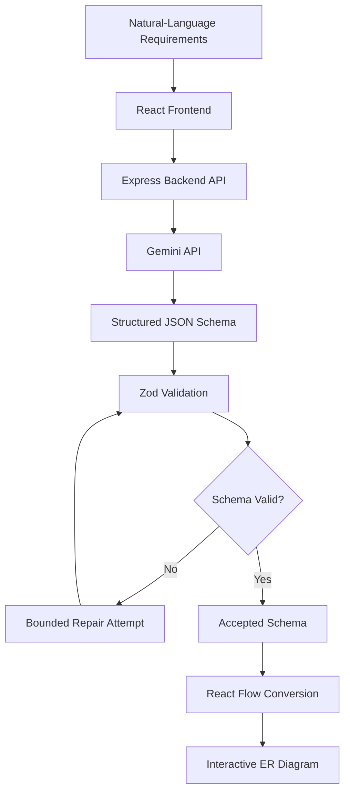

# SchemAI — Intelligent ER Diagram Generation Using Generative AI

**Transform natural-language database requirements into structured relational schemas and interactive Entity-Relationship Diagrams using Generative AI.**

SchemAI is a Generative AI-powered database design assistant that helps users convert plain-English requirements into structured database schemas and interactive ER diagrams.

It uses Google's Gemini API to interpret database requirements and generate structured JSON representations containing entities, attributes, keys, and relationships. The generated output is then checked using deterministic validation logic before being displayed as an interactive diagram.

The project combines LLM-based schema generation with application-level validation to make database modelling more accessible, consistent, and easier to understand.

## Table of Contents

- [Overview](#overview)
- [Problem Statement](#problem-statement)
- [Implemented Features](#implemented-features)
- [How It Works](#how-it-works)
- [Example](#example)
- [Technology Stack](#technology-stack)
- [System Architecture](#system-architecture)
- [Schema Representation](#schema-representation)
- [Validation Strategy](#validation-strategy)
- [Project Structure](#project-structure)
- [Getting Started](#getting-started)
- [Environment Configuration](#environment-configuration)
- [API Overview](#api-overview)
- [Testing](#testing)
- [Limitations](#limitations)
- [Future Enhancements](#future-enhancements)
- [Contributing](#contributing)
- [License](#license)

## Overview

Designing a relational database from natural-language requirements involves identifying entities, defining attributes, selecting primary and foreign keys, and determining relationships between entities.

These tasks can be challenging, particularly for beginners who may not be familiar with database modelling concepts.

SchemAI simplifies the initial database design process by allowing users to describe their requirements in plain English. A Gemini model interprets the description and generates a structured database schema in JSON format.

The backend validates the generated schema using Zod and custom semantic checks. Once validated, the frontend converts the structured schema into an interactive ER diagram using React Flow.

Instead of relying on an AI-generated diagram image, SchemAI uses structured data as the source of truth for visualization.

## Problem Statement

Translating informal requirements into a relational database design can be time-consuming and difficult.

Some common challenges include:

- Identifying entities and their attributes from unstructured requirements.
- Determining relationships and cardinalities.
- Representing primary and foreign keys correctly.
- Modelling many-to-many relationships.
- Checking consistency between related entities.
- Visualizing the resulting database structure.

SchemAI addresses the initial database modelling process through LLM-based requirement interpretation, structured schema generation, and deterministic validation.

## Implemented Features

### 1. Natural-Language-to-Schema Generation

Users can describe their database requirements in plain English.

The application integrates Google's Gemini API to generate structured JSON schemas containing:

- Entities and their attributes.
- Primary key and foreign key definitions.
- Attribute data types and constraints.
- Relationships between entities.
- Relationship cardinalities.

The generated output follows a predefined schema structure rather than returning unstructured text.

### 2. Deterministic Schema Validation

LLM-generated output is not trusted automatically.

SchemAI uses Zod and custom semantic validation rules to check the generated schema before accepting it.

Validation covers:

- Duplicate entity and attribute names.
- Missing or invalid identifiers.
- Invalid foreign key references.
- Relationships referencing nonexistent entities.
- Inconsistent relationship definitions.
- Supported data types and cardinalities.

The generation pipeline also includes a bounded repair attempt when the initial model output is invalid.

### 3. Interactive ER Diagram Visualization

Validated schemas are converted into interactive diagrams using React Flow (`@xyflow/react`).

Implemented visualization capabilities include:

- Entity nodes with attribute details.
- Primary key and foreign key indicators.
- Relationship edges between entities.
- Cardinality representation.
- Automatic diagram layout using Dagre.
- Zooming and panning.
- Node selection and layout reset.
- Full-screen diagram viewing.

### 4. Gemini Model Selection

Users can view and select compatible Gemini models through the application.

The backend retrieves the available model catalogue from Google's API and maintains a cached model list.

The implementation includes:

- Model compatibility checks.
- Backend-side model validation.
- Cached model catalogue.
- Refresh support.
- Handling of temporary provider failures.
- Explicit model selection for generation requests.

### 5. Conversation Persistence

SchemAI includes MongoDB-backed conversation storage using Mongoose.

When MongoDB is configured, the application can store conversation information and retrieve saved conversations.

The conversation model includes:

- Conversation title.
- Generated schema.
- Messages.
- Timestamps.
- Schema version information.

MongoDB is optional for the stateless schema-generation workflow.

## Natural-Language Schema Refinement

Users type an ordinary instruction ("Make Customer email unique", "Each employee belongs to exactly one department", "Make student_id the primary key of Student") under the diagram. The pipeline is:

```text
instruction -> load the stored schema (by conversation id, with its version)
            -> Gemini proposes OPERATIONS (never a replacement schema)
            -> operation normalizer (equivalent shapes -> one canonical contract)
            -> deterministic executor on a clone of the schema
            -> Zod + semantic + consistency validation
            -> atomic, version-checked save (409 on a concurrent change)
            -> frontend replaces its schema and re-lays-out the React Flow diagram
```

- The operation contract (names, required fields, aliases) lives in `backend/src/services/refinement/operationContract.js`; the normalizer, Zod schema and executor all read it.
- Removing an entity removes the relationships attached to it; foreign keys in *other* entities (or anything that would redesign another entity's primary key) are only removed after the user explicitly agrees, otherwise the user is asked.
- A failed, invalid or conflicting refinement never changes the saved schema or the diagram.
- Without a saved conversation (e.g. the sample schema) a refinement is applied to the diagram only; the UI says so.

## How It Works

SchemAI separates AI-based interpretation from deterministic application logic.



The workflow follows these steps:

1. The user enters database requirements in plain English.
2. The frontend sends the requirements and selected Gemini model to the backend.
3. The backend sends a structured generation prompt to Gemini.
4. Gemini returns a JSON representation of the proposed database schema.
5. The backend parses and validates the generated output.
6. If validation fails, the generation service attempts a bounded repair.
7. The validated schema is returned to the frontend.
8. React Flow converts the schema into entity nodes and relationship edges.
9. The user can inspect the resulting database structure through the interactive diagram.

Invalid generated schemas are not returned as successful results.

## Example

### Input

```text
Create a database for an employee management system.

Employees belong to departments and can work on multiple projects.
```

### Expected Schema

The generated schema can contain entities such as:

- **Employee** — employee information.
- **Department** — department information.
- **Project** — project details.
- **EmployeeProject** — an associative entity representing employee-project assignments.

Possible relationships:

```text
Department 1 ───── N Employee

Employee 1 ───── N EmployeeProject

Project 1 ───── N EmployeeProject
```

The generated entities, attributes, keys, and relationships are represented in structured JSON and validated before visualization.

## Technology Stack

| Component | Technology |
|---|---|
| Frontend | React 18, JavaScript |
| Build Tool | Vite |
| Styling | Tailwind CSS |
| Diagram Visualization | React Flow (`@xyflow/react`) |
| Automatic Layout | Dagre (`@dagrejs/dagre`) |
| Backend | Node.js, Express.js |
| Generative AI | Google Gemini API (`@google/genai`) |
| Schema Validation | Zod, custom semantic validation |
| Database | MongoDB |
| Database ODM | Mongoose |
| Testing | Node.js Test Runner, Vitest, Testing Library |

## System Architecture

SchemAI follows a frontend-backend architecture.

**Frontend**
- Collects natural-language database requirements.
- Provides Gemini model selection.
- Displays generated schema information.
- Renders interactive ER diagrams.
- Displays validation information.

**Backend**
- Exposes REST API endpoints.
- Handles schema generation requests.
- Coordinates communication with Gemini.
- Parses and validates structured model output.
- Manages model compatibility and provider errors.
- Handles optional conversation persistence.

**Generative AI Layer**
- Uses Google Gemini to interpret natural-language database requirements.
- Produces structured JSON schema output.

**Validation Layer**
- Uses Zod for structural validation.
- Applies custom semantic checks to database entities, attributes, keys, and relationships.
- Prevents invalid generated output from being accepted.

**Visualization Layer**
- Converts accepted JSON schemas into React Flow nodes and edges.
- Uses Dagre for automatic node positioning.

## Schema Representation

The application uses a structured JSON representation as the common source of truth.

The schema consists primarily of two collections:

- `entities`
- `relationships`

An entity contains information such as its ID, name, description, and attributes.

An attribute can contain:

- Name.
- Data type.
- Primary key indicator.
- Foreign key indicator.
- Nullable constraint.
- Unique constraint.
- Reference information.

Relationships contain source and target entities, relationship names, and cardinalities.

Supported cardinalities include:

- One-to-One (1:1)
- One-to-Many (1:N)
- Many-to-Many (N:M)

The model is designed to represent many-to-many relationships through associative entities.

## Validation Strategy

A key design decision in SchemAI is separating LLM-generated proposals from application-level validation.

The Gemini model proposes a database structure, but the application checks the output before presenting it as a valid schema.

The validation process includes:

1. Parsing the generated JSON.
2. Checking required fields and supported data types.
3. Detecting duplicate entity and attribute names.
4. Checking primary key definitions.
5. Verifying foreign key references.
6. Checking relationship consistency and cardinalities.
7. Returning validation errors when the generated schema is invalid.

Validation reduces structural errors, but it cannot guarantee that the generated design perfectly captures every business requirement. Users should review the generated schema before using it in a real application.

## Project Structure

The project is organized into separate frontend and backend applications.

```text
SchemAI/
│
├── frontend/
│   ├── src/
│   │   ├── components/
│   │   ├── pages/
│   │   ├── services/
│   │   └── utils/
│   ├── package.json
│   └── ...
│
├── backend/
│   ├── src/
│   │   ├── controllers/
│   │   ├── routes/
│   │   ├── services/
│   │   ├── models/
│   │   ├── validators/
│   │   └── ...
│   ├── package.json
│   └── ...
│
├── package.json
├── .gitignore
└── README.md
```

*Directory names are illustrative; refer to the repository for the exact current file organization.*

## Getting Started

### Prerequisites

- Node.js and npm.
- Google Gemini API key with access to a compatible model.
- MongoDB instance (optional, for conversation persistence).

### 1. Clone the Repository

```bash
git clone https://github.com/ZarrarPeshimam/SchemAI.git

cd SchemAI
```

### 2. Install Dependencies

Install root dependencies if required by the workspace:

```bash
npm install
```

Install backend dependencies:

```bash
cd backend
npm install
```

Install frontend dependencies:

```bash
cd ../frontend
npm install
```

### 3. Configure Environment Variables

Create a `.env` file inside the backend directory.

Refer to the environment configuration section below.

### 4. Start the Backend

```bash
cd backend
npm run dev
```

The backend runs on port `5000` by default.

### 5. Start the Frontend

Open another terminal:

```bash
cd frontend
npm run dev
```

The frontend runs on port `3000` by default.

Open the frontend in your browser at:

```text
http://localhost:3000
```

Follow the actual package scripts if they differ from these commands.

## Environment Configuration

The backend uses environment variables for provider credentials and application configuration.

Example backend `.env`:

```env
PORT=5000
CLIENT_ORIGIN=http://localhost:3000

GEMINI_API_KEY=your_gemini_api_key
GEMINI_MODEL=your_compatible_model_id
GEMINI_TIMEOUT_MS=180000

MONGODB_URI=mongodb://localhost:27017/schemai
```

**Important:**

- Keep API keys on the backend.
- Never expose private API credentials in frontend code.
- Do not commit `.env` files to GitHub.
- MongoDB configuration is required for persistent conversation storage.

## API Overview

The backend exposes REST endpoints under `/api`.

| Method | Endpoint | Purpose |
|---|---|---|
| GET | `/api/health` | Check backend availability. |
| GET | `/api/models` | Retrieve compatible Gemini models. |
| GET | `/api/schema` | Retrieve the application's sample schema. |
| POST | `/api/schema/generate` | Generate a database schema from natural-language requirements. |
| POST | `/api/schema/validate` | Validate a structured schema. |
| POST | `/api/schema/refine` | Apply a plain-English change to a schema. Body: `instruction`, `model`, and either `conversationId` (+ optional `schemaVersion`; the stored schema is authoritative) or `schema` (stateless, nothing is saved). Returns `applied` (with the validated schema and new version) or `needs_clarification`. Errors: `409 SCHEMA_VERSION_CONFLICT`, `404`, `503`, `422`, `429`, `504`. |
| GET | `/api/conversations` | Retrieve saved conversations when MongoDB is connected. |
| GET | `/api/conversations/:id` | Retrieve a saved conversation when MongoDB is connected. |

Refer to the backend routes for the exact request and response contracts.

## Testing

The repository includes automated test files for different parts of the application.

**Backend testing**

```bash
cd backend
npm test
```

**Frontend testing**

```bash
cd frontend
npm test
```

**Frontend production build**

```bash
cd frontend
npm run build
```

The test suite includes coverage for areas such as schema generation, validation, model selection, frontend rendering, and schema-to-diagram conversion.

Tests requiring live provider access or MongoDB may need valid environment configuration. The presence of test files does not imply that every integration test has been verified against a live service.

## Limitations

- Gemini may infer incorrect entities, attributes, or relationships when requirements are ambiguous.
- Validation only checks the structural and semantic rules implemented in the application.
- A schema can pass validation and still require manual review to ensure it meets the intended business requirements.
- The application depends on Gemini API availability, quotas, and model compatibility.
- MongoDB is required for persistent conversation history.
- Large schemas may make the ER diagram harder to navigate.
- Natural-language refinement depends on Gemini correctly interpreting the instruction; the application validates every result but cannot verify that it matches the user's business intent. Column defaults, check constraints, indexes and composite foreign keys are not part of the schema model and cannot be refined.
- PostgreSQL SQL generation is not currently integrated into the working application.

## Future Enhancements

Potential improvements include:

- Reliable natural-language schema refinement.
- PostgreSQL SQL generation from validated schemas.
- Data dictionary generation.
- ER diagram export in PNG, SVG, or PDF formats.
- Schema history comparison with undo and redo.
- Improved clarification questions for ambiguous requirements.
- Database normalization recommendations.
- Support for additional SQL dialects.
- Improved diagram layout for large schemas.

## Contributing

Contributions, suggestions, and bug reports are welcome.

When contributing, prioritize:

- Schema correctness.
- Reliable validation.
- Separation of AI inference from application logic.
- Maintainable frontend and backend code.
- Clear error handling.

## License

A license has not yet been selected. A suitable open-source license should be added before distributing the project under an explicit license.

---

**SchemAI — From natural-language requirements to structured database design.**