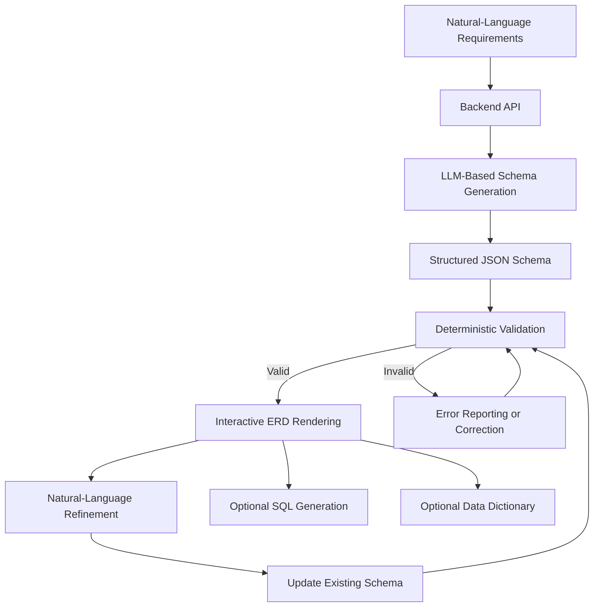

# SchemAI — Intelligent ER Diagram Generation and Schema Refinement

**Turn natural-language database requirements into structured schemas and interactive Entity-Relationship Diagrams using Generative AI.**

SchemAI is a GenAI-powered database design platform that helps users transform plain-English requirements into structured database schemas and connected ER diagrams. It aims to simplify database modeling by using Large Language Models (LLMs) to infer entities, attributes, keys, relationships, and cardinalities.

Beyond initial generation, SchemAI is designed to support natural-language schema refinement, deterministic validation, and optional SQL generation—all based on a common structured schema representation.

> **Project status:** In development. Features and technologies described below may be planned rather than implemented in the current version.

## Table of Contents

- [Overview](#overview)
- [Problem Statement](#problem-statement)
- [Key Features](#key-features)
- [How It Works](#how-it-works)
- [Example](#example)
- [Proposed Technology Stack](#proposed-technology-stack)
- [System Architecture](#system-architecture)
- [Planned API Structure](#planned-api-structure)
- [Getting Started](#getting-started)
- [Environment Configuration](#environment-configuration)
- [Validation Strategy](#validation-strategy)
- [Project Scope](#project-scope)
- [Limitations](#limitations)
- [Future Enhancements](#future-enhancements)
- [Contributing](#contributing)
- [License](#license)

## Overview

Designing a database from natural-language requirements requires identifying entities, selecting attributes, defining primary and foreign keys, determining relationship cardinalities, and resolving many-to-many relationships.

SchemAI aims to automate much of this process through a GenAI-powered workflow.

Instead of generating a static diagram image, the system uses an LLM to produce a structured schema. The schema is validated by application logic and then rendered as an interactive ER diagram.

This structured approach also allows the same database model to support future operations such as schema refinement, SQL generation, and data dictionary creation.

## Problem Statement

Translating informal requirements into a correct relational database design can be challenging, especially for users who are unfamiliar with database modeling concepts.

Common challenges include:

- Identifying entities and their attributes from unstructured requirements.
- Determining relationships and cardinalities.
- Modeling many-to-many relationships.
- Maintaining consistency between primary keys and foreign keys.
- Updating an existing schema when requirements change.
- Converting a database model into SQL definitions.

SchemAI addresses these challenges by combining LLM-based requirement interpretation with structured schema processing and deterministic validation.

## Key Features

### 1. Natural-Language-to-ERD Generation

Describe a database in plain English and let the LLM propose a structured database model.

The system is designed to infer:

- Entities and attributes.
- Primary and foreign keys.
- One-to-one, one-to-many, and many-to-many relationships.
- Relationship cardinalities.
- Associative entities where required.

### 2. Interactive ER Diagram

Render the generated schema as a connected ER diagram rather than a static AI-generated image.

Planned diagram capabilities include:

- Entity nodes with attribute lists.
- Primary key and foreign key indicators.
- Relationship edges with cardinality labels.
- Zooming and panning.
- Readable node positioning.

### 3. Natural-Language Schema Refinement

Modify a previously generated schema using follow-up instructions.

Example commands:

- `Add salary to Employee.`
- `Change salary to DECIMAL.`
- `Rename employee_name to full_name.`
- `Make email unique.`
- `Add a Department entity.`
- `Employees can work on multiple projects.`

The system is intended to apply the requested change to the existing structured schema, validate the result, and update the ER diagram while preserving unaffected components.

### 4. Deterministic Schema Validation

Application-level validation is intended to detect structural problems such as:

- Duplicate entity or attribute names.
- Missing primary keys.
- Invalid foreign key references.
- Relationships referencing nonexistent entities.
- Inconsistent cardinalities.
- Invalid data types or conflicting constraints.

LLM-generated output should be validated in code rather than trusted automatically.

### 5. SQL Generation — Planned

Generate SQL `CREATE TABLE` statements from the current structured schema, including appropriate primary key and foreign key constraints.

### 6. Data Dictionary — Planned

Generate documentation describing entities, attributes, data types, constraints, and their intended meanings.

## How It Works

The proposed workflow separates AI-based interpretation from deterministic application logic.



The structured schema acts as the source of truth. The diagram and optional outputs are derived from that schema.

## Example

### Input

```text
Create a database for an employee management system.
Employees belong to departments and can work on multiple projects.
```

### Expected schema

The LLM should propose a model containing entities such as:

- **Employee** — employee information.
- **Department** — department information.
- **Project** — project details.
- **EmployeeProject** — an associative entity representing employee-project assignments.

Possible relationships:

```text
Department 1 ───── N Employee

Employee 1 ───── N EmployeeProject

Project 1 ───── N EmployeeProject
```

The exact attributes, keys, and cardinalities should be inferred from the requirements and validated by the application.

### Follow-up refinement

```text
Add salary to Employee.
```

The schema is updated to include the new attribute.

```text
Salary should be DECIMAL and cannot be null.
```

The attribute's data type and nullability are updated, and the diagram is re-rendered.

```text
Generate SQL for this schema.
```

The SQL generator uses the latest structured schema rather than generating a separate, potentially inconsistent model.

## Proposed Technology Stack

The following technologies are candidates for the implementation; the final stack may change during development.

| Component | Proposed technology |
|---|---|
| Frontend | React |
| Language | JavaScript |
| ER diagram rendering | React Flow |
| Backend API | Node.js and Express.js |
| GenAI integration | LLM provider SDK |
| GenAI orchestration | LangChain.js, if useful |
| Structured data validation | Zod |
| Schema representation | JSON |
| Persistence | MongoDB or PostgreSQL, if needed |

### GenAI integration

An LLM provider will be selected based on API access, cost, model quality, and structured-output support. Potential options include Gemini, OpenAI, and compatible providers such as Groq.

LangChain.js is optional. A direct SDK integration may be sufficient for the initial implementation.

A separate Python service using FastAPI, LangChain, and Pydantic may be considered if a clear technical or academic requirement justifies it. Python is not required simply because the project uses Generative AI.

## System Architecture

The proposed architecture consists of the following components:

**Frontend**
- Collects database requirements and refinement instructions.
- Displays the structured ER diagram.
- Presents validation feedback and optional generated outputs.

**Backend**
- Exposes endpoints for schema generation and refinement.
- Coordinates LLM requests.
- Processes and validates structured schema data.
- Produces optional SQL and data dictionary outputs.

**GenAI Layer**
- Interprets natural-language requirements.
- Proposes entities, attributes, relationships, and constraints.
- Interprets follow-up instructions and proposes schema modifications.

**Validation Layer**
- Checks structural consistency and references.
- Reports invalid schema elements.
- Ensures proposed corrections are validated again.

**Schema Representation**
- Stores the current model in a consistent JSON structure.
- Acts as the source of truth for the ER diagram and derived outputs.

## Planned API Structure

These endpoints describe the intended API design and are not necessarily implemented yet.

| Method | Endpoint | Purpose |
|---|---|---|
| `POST` | `/api/schema/generate` | Generate a schema from natural-language requirements. |
| `POST` | `/api/schema/refine` | Apply a natural-language change to an existing schema. |
| `POST` | `/api/schema/validate` | Validate a structured schema. |
| `POST` | `/api/schema/sql` | Generate SQL from a schema. |
| `POST` | `/api/schema/dictionary` | Generate a data dictionary. |

Example generation request:

```json
{
  "requirements": "Create a database for an online bookstore."
}
```

The response should contain a structured schema that the frontend can render. The exact response format will be defined during implementation.

## Getting Started

SchemAI is under development. Follow these steps once the corresponding project files and scripts have been created.

### Prerequisites

- Node.js and npm.
- An API key for the selected LLM provider.
- Git.

### Installation

### Installation

Clone the repository and install dependencies:

```bash
git clone https://github.com/ZarrarPeshimam/SchemAI.git
cd SchemAI
```

Install backend dependencies:

```bash
cd backend
npm install
```

Install frontend dependencies:

```bash
cd ../frontend
npm install
```

### Running the Application

You can start both services independently or using root workspace scripts:

#### 1. Backend (Express.js on port 5000)

```bash
cd backend
npm run dev
# Or from root:
npm run dev:backend
```

Run automated backend tests:

```bash
cd backend
npm test
# Or from root:
npm run test:backend
```

#### 2. Frontend (Vite + React on port 3000)

```bash
cd frontend
npm run dev
# Or from root:
npm run dev:frontend
```

## Environment Configuration

Store API credentials in environment variables. Never expose private LLM API keys in frontend code or commit them to version control.

An example backend `.env` file:

```env
PORT=5000
LLM_PROVIDER=your_provider
LLM_API_KEY=your_api_key
```

These are illustrative variable names. The actual names must match the selected provider SDK and application configuration.

Add `.env` to `.gitignore`:

```gitignore
node_modules/
.env
dist/
```

Do not commit real API keys or credentials.

## Validation Strategy

SchemAI is designed to combine LLM inference with deterministic checks.

The LLM proposes the database design, but application code should verify matters such as:

- Whether referenced entities and attributes exist.
- Whether foreign keys reference valid attributes.
- Whether entity and attribute names are unique.
- Whether primary keys and constraints are represented consistently.
- Whether relationship definitions are structurally valid.
- Whether data types belong to the supported set.

Validation cannot guarantee that a schema perfectly captures the user's intent. Ambiguous requirements may require clarification, and inferred relationships should remain reviewable by the user.

## Project Scope

### Minimum Viable Product

- Natural-language database requirements.
- LLM-based schema generation.
- Structured JSON representation.
- Entity and relationship inference.
- Interactive ERD rendering.
- Deterministic schema validation.
- Natural-language schema refinement.
- ERD updates after refinement.

### Future Enhancements

- SQL generation.
- Data dictionary generation.
- ERD export.
- Schema revision history and undo.
- Clarification questions for ambiguous requirements.
- Basic normalization recommendations.

### Out of Scope

- Building complete business applications or ERP systems.
- Deploying generated databases to production.
- Generating complete application codebases.
- Training a foundation model from scratch.
- Complex multi-agent orchestration.
- Unlimited conversational memory.

## Limitations

- LLMs may infer incorrect entities, attributes, or cardinalities.
- Natural-language requirements can be ambiguous or incomplete.
- Deterministic validation catches defined structural errors but cannot prove that a model fully captures business requirements.
- SQL generation may require dialect-specific handling.
- Diagram readability may become challenging for large schemas.
- The initial implementation may support only a defined subset of schema modifications and data types.

The generated schema should be reviewed before being used in a real application.

## Contributing

Contributions, bug reports, and suggestions are welcome as the project develops.

When proposing changes, prioritize:

- Schema correctness.
- Reliable validation.
- Clear separation between AI inference and application logic.
- Preservation of existing schema components during refinement.
- Readable, maintainable code.

## License

A license has not yet been selected. Add a suitable open-source license file before distributing the project under an explicit license.

---

**SchemAI — From natural-language requirements to structured database design.**
